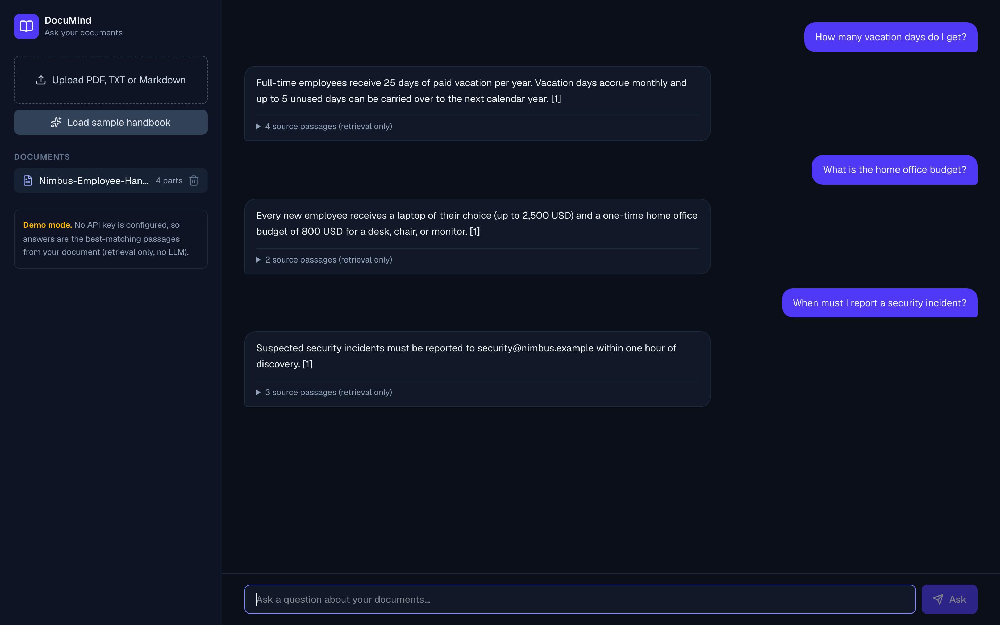

# DocuMind: RAG Document Assistant

Ask questions about your documents and get cited answers. Built with **Next.js (App Router)**, **TypeScript**, **Tailwind CSS**, and the **Anthropic Claude API**.



> **Demo note:** the app runs without any API key in **demo mode**: it retrieves the most relevant passages from your document and shows the best-matching sentence (retrieval only, no LLM). Add an `ANTHROPIC_API_KEY` and the same retrieval feeds Claude, which writes a grounded answer with citations.

## How it works

1. **Ingest:** upload a PDF, TXT, or Markdown file. The server extracts the text (`unpdf` for PDFs) and splits it into overlapping chunks along paragraph and sentence boundaries.
2. **Retrieve:** for each question, chunks are ranked with **BM25** (a keyword-based ranking function), implemented from scratch in TypeScript with no extra service required.
3. **Answer:** the top passages are sent to Claude with strict instructions to answer **only from the passages**, cite them as `[1]`, `[2]`, and say so when the answer isn't in the document.
4. **Show your work:** every answer lists the source passages it used, so users can verify it.

## Features

- PDF, TXT, and Markdown upload (up to 3 MB), multiple documents at once
- Cited answers with expandable source passages and relevance scores
- One-click sample document, so the app is demo-ready without any files
- Works with or without an API key (clearly labeled in the UI)
- Basic protection: input limits, in-memory rate limiting, and prompt-injection-aware system prompt (document text is treated as untrusted data)
- Configurable model through `ANTHROPIC_MODEL`

## Tech Stack

Next.js · React · TypeScript · Tailwind CSS · `@anthropic-ai/sdk` · `unpdf` · Lucide icons

## Project Structure

```text
src/
├── app/
│   ├── api/ingest/route.ts   # File upload, text extraction, chunking
│   ├── api/ask/route.ts      # Retrieval + Claude answer (or demo-mode answer)
│   └── api/status/route.ts   # Reports whether an API key is configured
├── components/ChatApp.tsx    # Chat UI
└── lib/
    ├── chunk.ts              # Overlapping text chunker
    ├── retrieve.ts           # BM25 ranking + sentence picker
    ├── rateLimit.ts          # In-memory rate limiter
    └── sample.ts             # Fictional sample handbook
```

## Getting Started

```bash
git clone https://github.com/SeriDaron/ai-rag-document-assistant.git
cd ai-rag-document-assistant
npm install
cp .env.example .env.local   # optional: add your ANTHROPIC_API_KEY
npm run dev
```

Open [http://localhost:3000](http://localhost:3000) and click **Load sample handbook**.

## Design decisions and limitations

- **Stateless by design:** document chunks live in the browser and are sent with each question. This keeps the demo simple and private (nothing is stored on the server), but it caps document size.
- **Keyword retrieval (BM25), not embeddings:** fast, dependency-free, and predictable. For large or paraphrase-heavy corpora, swap `retrieve.ts` for a vector search (pgvector, Pinecone, Qdrant) with an embedding model; the rest of the pipeline stays the same.
- **Scanned PDFs** need OCR first; the app reports when no text can be extracted.
- **Rate limiting** is in-memory (per server instance). Use Redis or an edge rate limiter for production.
- **Public deployments:** if you deploy with a real API key, set spending limits on the key.

## Extending it

- Persist documents and chunks in a database, add user accounts
- Embedding-based or hybrid (BM25 + vector) retrieval
- Streaming responses
- Support for DOCX and web page ingestion

## Need something similar?

I build RAG assistants, document-processing tools, and AI integrations. Feel free to reach out.
